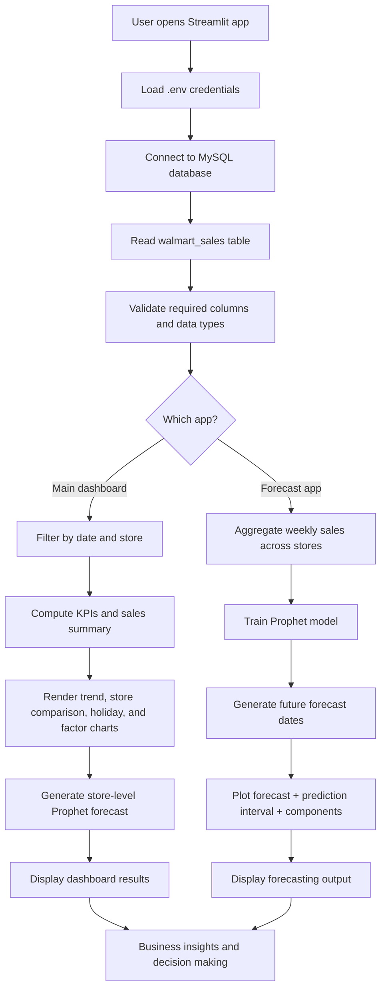

# aiMLProject

`aiMLProject` is a retail analytics and forecasting project built around Walmart sales data. The solution combines a MySQL-backed data layer, a Streamlit dashboard, and a Prophet forecasting workflow to help users explore sales performance, compare stores, analyze market conditions, and predict future weekly demand.

This project is designed to turn raw business data into interactive insight. Instead of only reporting static numbers, it gives users the ability to filter by date and store, inspect sales trends, compare regular vs. holiday weeks, examine the impact of external market factors, and generate forward-looking forecasts.

## Project overview

The main purpose of the project is to analyze historical Walmart weekly sales and create actionable business intelligence from it. The project relies on a table named `cusNew.walmart_sales`, which contains the following required fields:

- `Store`
- `Date`
- `Weekly_Sales`
- `Holiday_Flag`
- `Temperature`
- `Fuel_Price`
- `CPI`
- `Unemployment`

These columns make it possible to do both descriptive analytics and predictive forecasting. The data captures weekly sales along with conditions such as temperature, fuel prices, customer price index, unemployment, and holiday effect.

The project is built around two main user-facing entry points:

1. `app.py` – a polished dashboard for interactive business exploration
2. `cusDataSet_app.py` – a focused forecast app that loads the same data and trains a Prophet model for future sales prediction

The shared database connection logic is centralized in `db_connect.py`, which handles environment configuration and MySQL access.

## Why this project matters

Retail teams often need to answer questions such as:

- Which stores are performing best?
- How do sales change around holiday weeks?
- Is there a relationship between weather, fuel prices, or unemployment and sales?
- What will sales look like in the future for a given store or for the entire chain?

This project turns those questions into an interactive dashboard that business users can navigate without writing SQL or Python code. It combines descriptive reporting with predictive forecasting, which makes it useful for both operational reporting and planning.

## Architecture and component flow

The application follows a simple and clean architecture:

- Data source: MySQL database
- Access layer: `db_connect.py`
- Presentation layer: Streamlit dashboards
- Forecasting engine: Prophet
- Visualization layer: Plotly charts

The core logic is straightforward:

1. Load the sales dataset from MySQL.
2. Validate required columns and convert data types.
3. Filter by date and store selection.
4. Compute summary metrics and charts.
5. Visualize sales trends, store comparisons, holiday effects, and market factor relationships.
6. Train a Prophet forecasting model on historical performance.
7. Present actual vs. predicted values along with prediction intervals.

## File structure

```text
aiMLProject/
├── README.md
├── app.py
├── cusDataSet.ipynb
├── cusDataSet_app.py
├── dataModelTrain.ipynb
├── db_connect.py
├── prophet_model.pkl
└── .env   (local config, not committed)
```

### Main files

- `db_connect.py`
  - Loads environment variables from `.env`
  - Connects to MySQL using `mysql.connector`
  - Reads the `walmart_sales` table
  - Validates and returns a Pandas DataFrame

- `app.py`
  - Main dashboard for interactive sales intelligence
  - Contains filters for date range, stores, and market factor
  - Produces KPI cards, trend charts, store rankings, holiday comparisons, and forecasts
  - Uses Plotly for analytics visualizations

- `cusDataSet_app.py`
  - Alternative forecast-focused app derived from the notebook workflow
  - Summarizes raw data and descriptive statistics
  - Aggregates weekly sales across all stores
  - Trains a Prophet model
  - Displays forecast results and trend/seasonality components

- `cusDataSet.ipynb` and `dataModelTrain.ipynb`
  - Jupyter notebooks used for exploratory analysis and model training
  - These notebooks document the forecasting workflow used later in Streamlit apps

- `prophet_model.pkl`
  - Serialized Prophet model artifact that can be reused or inspected after training

## Data pipeline

The data pipeline is as follows:

1. MySQL connection is established with credentials from `.env` or environment variables.
2. `fetch_walmart_sales()` retrieves all rows from `cusNew.walmart_sales`.
3. Data is validated for required fields and converted to the proper types.
4. The dashboard filters the dataset based on user-selected dates and stores.
5. Aggregate summaries are computed, such as:
   - total sales
   - average weekly sales by store
   - best-performing store
   - holiday vs. non-holiday performance
6. Forecasts are generated using Prophet, either at the store level or across weekly totals.
7. Results are plotted using Plotly and displayed in the app.

This makes the project useful for both spreadsheet-like reporting and deeper predictive analysis.

## Main dashboard behavior (`app.py`)

The main dashboard is more than a chart viewer. It is a business intelligence app with the following capabilities:

- A sidebar toggle switches the dashboard and charts between light and dark themes. Its animated hero uses Three.js, GSAP, and anime.js from public CDNs, so an internet connection is needed for those animations.

### KPI summary
It calculates and displays:

- total sales in view
- average store-week sales
- number of stores in view
- best-performing store

These KPIs update automatically according to selected filters.

### Sales over time
This chart displays total weekly sales over a chosen date range and includes a 4-week rolling average to reveal short-term trends.

### Store performance
The dashboard ranks stores by total sales and helps identify the highest performers.

### Holiday vs. regular weeks
It compares average weekly sales for holiday and regular weeks to highlight the impact of seasonal promotions and special periods.

### Market factor relationship
Users can choose a market factor such as:

- Temperature
- Fuel Price
- CPI
- Unemployment

The chart plots that factor against weekly sales, helping users understand how external conditions affect performance.

### Store-level forecasting
For a selected store, the user can set a forecast horizon (for example 4 to 52 weeks). The app trains a Prophet model on that store's historical data and visualizes:

- actual sales history
- future forecast
- prediction interval
- confidence range

## Forecasting workflow (`cusDataSet_app.py`)

The second Streamlit app focuses on the forecasting workflow and is closer to a data-science pipeline:

1. Load all sales records from the MySQL database.
2. Convert dates to a consistent format.
3. Group sales by date and sum across all stores.
4. Rename columns into Prophet-compatible names: `ds` and `y`.
5. Train a `Prophet` model with weekly sales history.
6. Create future dates using a configurable horizon.
7. Predict future values and visualize the forecast.
8. Show trend and seasonality components through `plot_components_plotly`.

This app is especially useful for understanding how the time-series model works and how sales are expected to evolve over a future period.

## Environment configuration

Create a local `.env` file inside `aiMLProject/`:

```dotenv
MYSQL_HOST=127.0.0.1
MYSQL_PORT=3306
MYSQL_USER=root
MYSQL_PASSWORD=your-mysql-password
MYSQL_DATABASE=cusNew
```

Notes:

- `db_connect.py` reads `.env` automatically.
- Environment variables override values stored in `.env`.
- The `.env` file is intentionally not tracked by Git to keep credentials private.

## Installation and setup

The project uses its own virtual environment and pinned dependencies. From the repository root, create and activate it with:

```bash
python3 -m venv aiMLProject/.venv
source aiMLProject/.venv/bin/activate
python -m pip install --upgrade pip
python -m pip install -r aiMLProject/requirements.txt
```

To activate an environment that has already been created:

```bash
source aiMLProject/.venv/bin/activate
```

The requirements include dependencies for both Streamlit apps and the project notebooks. In VS Code, select `aiMLProject/.venv/bin/python` as the notebook kernel.

## Run the apps

From the repository root, run the main dashboard:

```bash
aiMLProject/.venv/bin/streamlit run aiMLProject/app.py
```

Run the forecasting app:

```bash
aiMLProject/.venv/bin/streamlit run aiMLProject/cusDataSet_app.py
```

## Project flowchart



## Summary

`aiMLProject` is a practical data-science and business-intelligence project that combines data access, dashboarding, and forecasting into a single workflow. It demonstrates how a retail dataset can be transformed into meaningful business insight through Python, MySQL, Streamlit, Plotly, and Prophet.

The value of the project is not just in the visual charts but in the end-to-end workflow: raw transactional data enters the system, is structured into a usable format, analyzed for trends and drivers, and ultimately used to anticipate the next few weeks of sales.

This makes the project a strong example of how AI and machine learning can support real-world retail decision-making.
